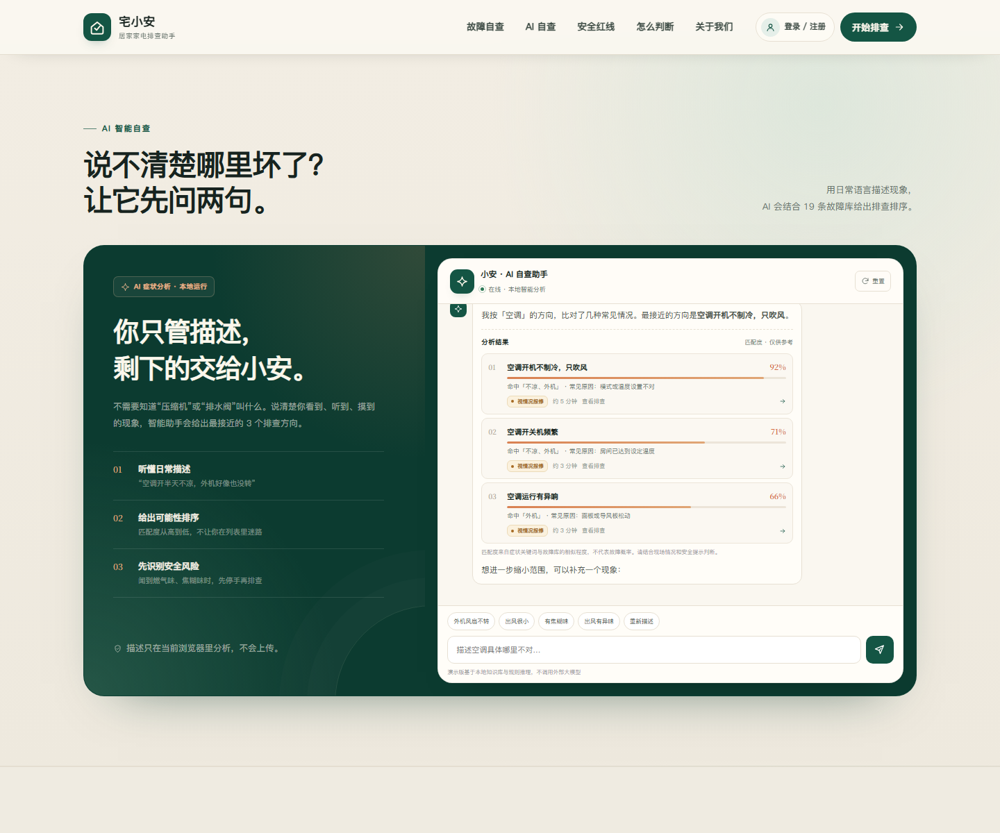
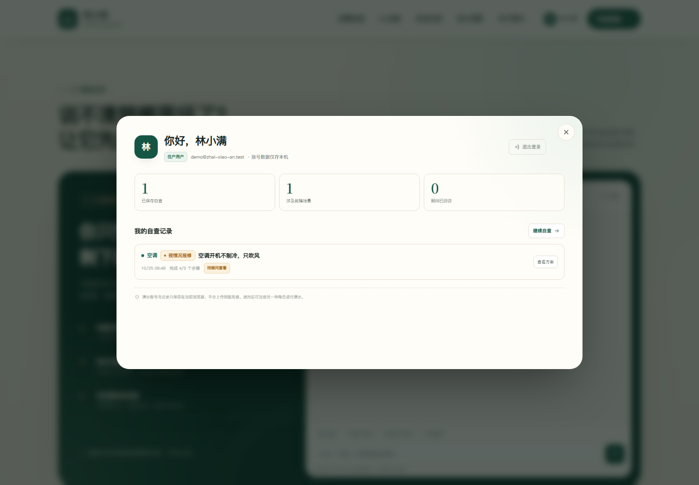

# 宅小安 · 居家家电简易排查助手

面向普通家庭的轻量化家电故障自查网站。覆盖空调、洗衣机、热水器、冰箱 4 类家电的 19 个高频小故障，帮助用户在报修前先判断：是设置问题、清洁问题，还是需要专业维修。

**在线访问：** https://userwang91.github.io/home-appliance-helper/






> 课程演示录制脚本见 [DEMO.md](DEMO.md)。

## 直接使用

双击 `index.html` 即可打开，无需安装任何依赖，也不需要联网。

如果想用本地服务器打开，可在本目录执行：

```powershell
python -m http.server 8765
```

然后访问 `http://127.0.0.1:8765/`。

## 主要功能

- **AI 智能自查**：支持自然语言描述、家电方向选择、症状关键词匹配、可能性排序和风险识别；分析在浏览器本地完成，不上传描述。
- **19 条故障自查方案**：每条都包含故障现象、可能原因、自助排查步骤、简易解决方法、报修触发条件和报修话术。
- **搜索与筛选**：支持“空调不制冷”“洗衣机不脱水”“燃气热水器不打火”等口语化搜索，标题命中优先排序。
- **演示账号体系**：可注册「住户用户」和「维修顾问」两种角色，密码经加盐摘要后保存。
- **自查记录闭环**：住户保存排查进度，维修顾问查看看板并标记回访，帮助演示不同类型账号的协作流程。
- **交互式自查清单**：在详情中逐项勾选步骤，自动显示完成进度。
- **风险分级**：优先自查、视情况报修、停用报修三种处理边界。
- **一键复制报修描述**：把现象、已做检查、机型占位符整理成一段可以直接发给师傅的话。
- **安全红线**：焦糊味、燃气味、漏水浸电、内胆漏水等情况先停用，不提供拆机和带电检测建议。
- **响应式布局**：适配手机、平板和桌面，并提供移动端导航菜单。
- **无障碍细节**：键盘可操作、弹窗焦点管理、Esc 关闭、焦点返回、减少动态效果适配。

## 课堂演示建议

1. 打开网站，先用 AI 自查输入“空调开半天不凉，外机好像也没转”，查看排序结果并打开一条方案。
2. 注册一个「住户用户」账号，逐项勾选自查步骤，点击「保存本次自查」。
3. 退出登录，再注册一个「维修顾问」账号，在顾问工作台看到住户记录并标记「已回访」。
4. 回到故障库，演示搜索、筛选和安全红线，完成产品全流程。

> 账号和自查记录使用浏览器 `localStorage` 保存，仅用于课程演示，请勿使用真实密码。生产环境应接入服务端认证与数据库。

## 文件结构

```
home-appliance-helper/
├── index.html              # 页面结构、图标与静态内容
├── assets/
│   ├── styles.css          # 基础视觉系统、响应式布局、详情弹窗
│   ├── features.css        # AI 自查、账号体系、个人中心样式
│   ├── data.js             # 4 类家电 / 19 条故障内容库
│   ├── app.js              # 搜索、筛选、详情弹窗、步骤进度、复制等交互
│   └── features.js         # AI 症状分析、注册登录、角色看板、自查记录
├── preview.png             # 桌面端首页预览
├── preview-mobile.png      # 手机端预览
├── preview-ai.png          # AI 智能自查预览
├── preview-account.png     # 个人中心预览
├── DEMO.md                 # 课程演示脚本与口播稿
└── README.md
```

## AI 能力说明

当前 AI 模块采用**本地规则引擎 + 症状关键词匹配 + 风险规则**实现，不调用外部大模型：

- 从用户自然语言中提取症状词和家电类型；
- 与 19 条结构化故障知识库比对并计算匹配度；
- 对焦糊味、燃气味、漏电等情况优先触发安全提醒；
- 全程在浏览器内运行，不上传用户描述。

这一定位强调**可解释、零接口成本、隐私友好**，适合作为课程原型；如果后续需要接入真实大模型，可在现有数据结构基础上替换分析层。

## 内容与安全边界

- 内容根据常见家电使用场景、产品说明书中的用户可操作事项和公开维修常识整理。
- 只提供用户可安全完成的检查：设置、清洁、摆放、外观观察、可见管路检查。
- 不提供拆外壳、带电检测、短接保护、加制冷剂、拆燃气部件等操作建议。
- 涉及燃气、漏电、焦糊味、内胆漏水或任何拆机操作时，站点会明确提示停用并联系专业人员。
- 本站内容仅作日常安全自查参考，不替代品牌售后、持证维修人员或燃气/电力专业人员的现场判断。

## 部署

整个目录为纯静态站点，可直接部署到 GitHub Pages、Netlify、Vercel 或任意静态服务器。
